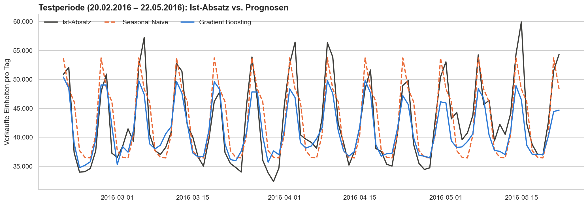
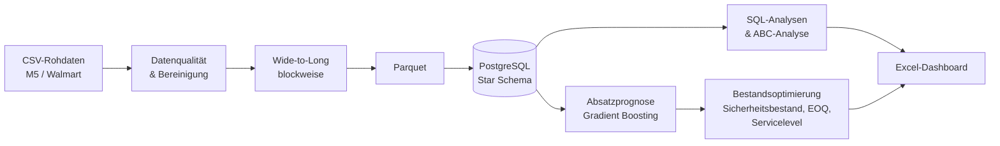
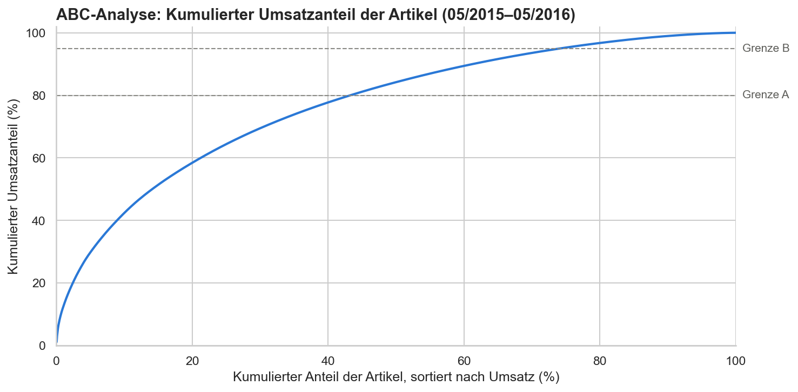
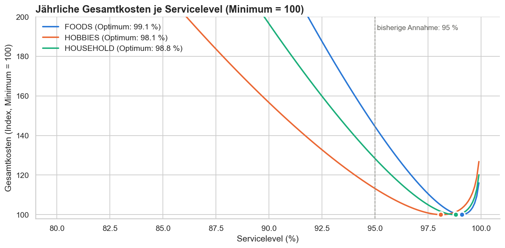

# Supply Chain Demand Forecasting & Inventory Optimization

**End-to-End-Projekt: von 59 Mio. Verkaufsdatensätzen zur kostenoptimalen Bestandsplanung**

Python · PostgreSQL · SQL · Machine Learning · Excel

---

## Ergebnisse auf einen Blick

| Bereich | Ergebnis |
|---|---|
| **Daten** | 59,2 Mio. Beobachtungen (3.049 Artikel, 10 Filialen, 1.941 Tage), vollständig validiert |
| **Data Warehouse** | Star Schema in PostgreSQL (1 Faktentabelle, 3 Dimensionstabellen) |
| **Prognose** | Gradient Boosting senkt den MAE gegenüber dem saisonalen Baseline-Modell um **12,9 %** (RMSE: −9,2 %) |
| **ABC-Analyse** | 43,2 % der Artikel erzeugen 80 % des Umsatzes |
| **Bestandsplanung** | Planung je Kategorie erfordert 19,8 % mehr Sicherheitsbestand als die aggregierte Planung (Risk Pooling) |
| **Optimierung** | Kostenoptimaler Servicelevel von 98,1–99,1 % statt pauschal 95 %; rund **26 % geringere Kosten** für Sicherheitsbestand und Fehlmengen |
| **Reporting** | Excel-Dashboard für Fachanwender |



---

## Fragestellung

Ungenaue Absatzprognosen führen im Einzelhandel zu leeren Regalen oder zu hoher Kapitalbindung im Lager. Das Projekt beantwortet drei Fragen:

1. Wie genau lässt sich der tägliche Absatz prognostizieren?
2. Welche Sicherheitsbestände und Bestellmengen ergeben sich daraus?
3. Welcher Servicelevel ist wirtschaftlich optimal?

---

## Vorgehen



Das Projekt folgt dem CRISP-DM-Prozess:

| Kapitel | Inhalt |
|---|---|
| 1. Business Understanding | Geschäftskontext, Ziele, Datengrundlage |
| 2. Data Understanding | Datenquellen, speicheroptimiertes Laden |
| 3. Datenqualität | Fehlende Werte, Duplikate, Referenzen, Plausibilität, Ausreißer |
| 4. Datenaufbereitung | Kalendermerkmale, Wide-to-Long-Transformation in 153 Blöcken, Parquet |
| 5. Datenintegration | Zusammenführung von Absatz-, Kalender- und Preisdaten |
| 6. Data Warehouse | Star Schema, Import mit `COPY`, Indizes, Validierung |
| 7. Explorative Analyse | Trends, Saisonalität, Kategorien, Filialen, ABC-Analyse, Nullabsatz |
| 8. Absatzprognose | Seasonal Naive vs. Gradient Boosting, zeitliche Validierung |
| 9. Bestandsoptimierung | Sicherheitsbestand, Meldebestand, EOQ, kostenoptimaler Servicelevel |
| 10. Reporting | Excel-Report mit Dashboard |

---

## Ausgewählte Ergebnisse

### Absatzprognose

| Modell | MAE | RMSE |
|---|---|---|
| Seasonal Naive (Baseline) | 3.204,72 | 4.091,03 |
| **Gradient Boosting** | **2.790,93** | **3.715,20** |

Testperiode: 20.02.2016–22.05.2016 (93 Tage). Die Daten wurden strikt chronologisch in Training, Validierung und Test aufgeteilt, um Data Leakage zu vermeiden. Die Prognose erfolgt rekursiv; mit wachsendem Horizont nimmt die Genauigkeit ab (Mai 2016).

### ABC-Analyse



### Kostenoptimaler Servicelevel

| Kategorie | Optimaler Servicelevel | Kostenersparnis ggü. 95 % | Bestellrhythmus (EOQ) |
|---|---|---|---|
| FOODS | 99,1 % | 30,8 % | ca. 5 Tage |
| HOUSEHOLD | 98,8 % | 22,1 % | ca. 7 Tage |
| HOBBIES | 98,1 % | 11,7 % | ca. 10 Tage |



---

## Technologien

| Bereich | Werkzeuge |
|---|---|
| Datenverarbeitung | Python, pandas, NumPy, PyArrow (Parquet) |
| Datenbank | PostgreSQL, psycopg2, pgAdmin 4 |
| Machine Learning | scikit-learn (HistGradientBoostingRegressor), SciPy |
| Visualisierung | Matplotlib, Seaborn |
| Reporting | Excel (openpyxl, Pivot-Tabellen, Dashboard) |Streamlit

---

## Projektstruktur

```
├── Supply_Chain_Demand_Forecasting_Inventory_Optimization.ipynb   # Hauptanalyse
├── sql/
│   ├── supply_chain.sql      # Schema, Tabellen, Indizes, Analyseabfragen
│   ├── 01_create_warehouse.sql
│   └── 02_create_indexes.sql
├── reports/
│   ├── supply_chain_report.xlsx        # Excel-Report mit Dashboard
│   ├── forecast_testperiode.png
│   ├── feature_importance.png
│   ├── abc_analyse.png
│   └── servicelevel_optimierung.png
├── requirements.txt
└── README.md
Streamlit
```

---

## Reproduktion

1. **Daten herunterladen:** [M5 Forecasting – Accuracy (Kaggle)](https://www.kaggle.com/competitions/m5-forecasting-accuracy/data). Benötigt werden `sales_train_evaluation.csv`, `calendar.csv` und `sell_prices.csv`. Die Rohdaten sind aufgrund ihrer Größe nicht im Repository enthalten.
2. **Umgebung einrichten:**
   ```bash
   pip install -r requirements.txt
   ```
3. **Datenbank anlegen:** PostgreSQL-Datenbank `supply_chain_dw` erstellen. Die Zugangsdaten werden über die lokale PostgreSQL-Konfiguration (z. B. `.pgpass`) gelesen, nicht im Code gespeichert.
4. **Notebook ausführen:** `Kernel → Restart & Run All`. Bereits importierte Tabellen und ein vorhandener Excel-Report werden erkannt und nicht überschrieben.

---

## Annahmen und Grenzen

- Beobachtete Verkäufe entsprechen nicht zwangsläufig der tatsächlichen Nachfrage, da keine Bestandsdaten vorliegen.
- Die Prognose erfolgt auf aggregierter Ebene; die Kategorieprognosen werden top-down abgeleitet.
- Lieferzeit (7 Tage) und Kostensätze (Lagerhaltung 20 % p. a., Bestellkosten 500 USD, entgangene Marge 30 %) sind Annahmen und im Notebook zentral anpassbar.
- Die Ergebnisse zeigen das methodische Vorgehen und ersetzen keine realen Bestellentscheidungen.

## Nächste Schritte

- Prognose auf Artikel- und Filialebene (z. B. mit LightGBM)
- Verfahren für intermittierende Nachfrage (Croston, TSB)
- Rolling-Origin-Validierung über mehrere Zeitfenster
- Simulation der Bestellpolitik mit tatsächlichen Verkaufsdaten

---

## Kontakt

**Melanie Florine Noubissi Chimi** · [LinkedIn]https://www.linkedin.com/in/melanie-florine-noubissi-chimi-a96969185/ · 
[E-Mail]melanie.chimi@yahoo.com
